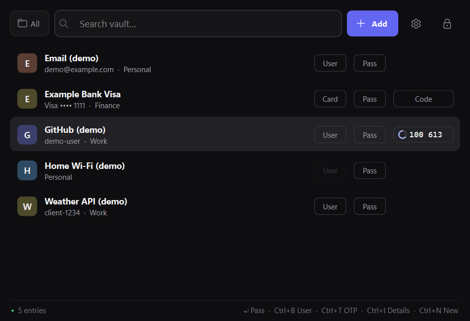
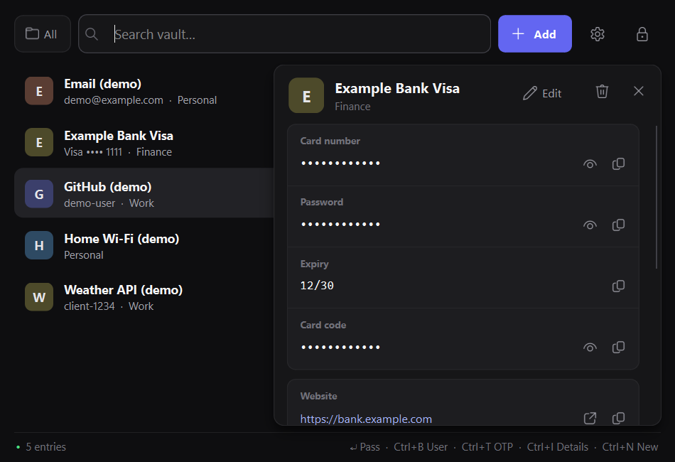

# Vaultline

[](https://github.com/evega85/vaultline/releases/latest)
[](https://github.com/evega85/vaultline/actions/workflows/ci.yml)
[](LICENSE)

**A fast, minimal password manager for Windows that opens your existing KeePass (`.kdbx`) file.**



- **Instant search.** Start typing and the list filters as you go. Arrow keys move, Enter copies the password.
- **One-click copy.** Every row has **User**, **Pass** and a live **one-time code** (TOTP) with a countdown. Click one to copy it.
- **Clipboard that cleans up after itself.** Copies clear after 20 seconds and stay out of Windows clipboard history (Win+V).
- **Cards.** Card number, password, expiry (MM / YY), card code, website and the bank's phone numbers, with **Card · Pass · Code** buttons.
- **Safe with cloud sync.** If Google Drive, OneDrive or Dropbox updates the file (say, after you edit on your phone), Vaultline reloads it. When you save, changes made elsewhere are merged in, not overwritten.
- **Works alongside other KeePass apps.** It's the same standard `.kdbx` (KDBX 4) file you already use in KeePassXC and KeePassium. There's no import and no lock-in.
- **Compact view.** Make the window narrow (or press **Ctrl+M**, or the button next to minimise) and it becomes a slim quick-search bar that grows with its results, sticks to the top of the screen, and can stay on top of other windows (📌).
- **Also:** folders, website icons, a password generator, PIN quick-unlock, auto-lock, quick switching between recent databases (Settings → Database), a tray icon, and a dark theme.

> Vaultline is an independent project. It is not affiliated with or endorsed by KeePass, KeePassXC or KeePassium.

---

## Quick start for Windows users (no Python required)

1. Go to the [**latest release**](../../releases/latest) and download **`Vaultline.exe`**.
2. Double-click it. Windows may say *"Windows protected your PC"*, because the app isn't code-signed yet. Click **More info → Run anyway**.
3. **Try it with the demo vault first:** download [`demo/sample.kdbx`](demo/sample.kdbx), click **Change** on the unlock screen, pick that file, and enter the password **`demo123`**. It contains only made-up entries, including a working one-time code and a test card.
4. When you're ready, open your own `.kdbx` file. **Try it on a copy of your database first.** Vaultline is careful (see below), but a copy costs you nothing.

Vaultline remembers which file you opened last. It never remembers your master password.

The first time you close the window, Vaultline asks whether to keep running in the system tray (so it opens instantly and the shortcut keeps working) or quit. Change it any time in Settings → Windows, where you can also have Vaultline start when you sign in to Windows (it waits in the tray). The tray icon's **Quit** always exits fully.



---

## Keyboard shortcuts

| Key | What it does |
|---|---|
| *just type* | Search (the search box always has focus) |
| ↑ / ↓ , PgUp / PgDn | Move through results |
| **Enter** or **Ctrl+C** | Copy password |
| **Ctrl+B** | Copy username (or card number) |
| **Ctrl+T** | Copy the current one-time code (or card code) |
| **Ctrl+I** or click a row | Show all fields of the entry |
| **Ctrl+E** or double-click | Edit the entry |
| **Ctrl+N** | New entry |
| **Ctrl+L** | Lock |
| **Ctrl+M** | Switch between the full window and the compact view |
| **F1** | Help: using the same vault in KeePassXC, KeePassium (iPhone) and KeePassDX (Android) |
| **Esc** | Close details → clear search → leave folder (it never hides the window) |

Right-click a row for more (copy URL, edit, delete).

---

## Security and how it works

- **Standard encryption.** Vaultline reads and writes standard KeePass KDBX 4 files using [pykeepass](https://github.com/libkeepass/pykeepass). Your data is encrypted exactly as KeePassXC would encrypt it.
- **Your master password is never stored**, not on disk and not in the settings file. Settings (last file opened, auto-lock time and so on) live in `%APPDATA%\Vaultline\config.json`.
- **Saving is designed not to corrupt your file:**
  1. The file on disk is re-read first. If another device changed it, your edit is applied on top of the newer copy.
  2. The new file is built in memory and decrypted again as a check before anything is written.
  3. The previous version is copied to `%LOCALAPPDATA%\Vaultline\backups` (last 10 kept).
  4. The new file is written to a temporary file and swapped in with one atomic rename, so a sync app never sees a half-written file.
- **Locking.** Auto-lock after 10 minutes of inactivity (adjustable). Optional PIN quick-unlock: after one full unlock, locking only asks for a PIN. The master password is required again after 3 wrong PINs or a restart.
- **Website icons** are downloaded straight from each entry's own website (like KeePassXC), never through a third-party service, and are stored inside your `.kdbx`. You can turn this off in Settings.
- **Recommendation:** keep your own backup of your `.kdbx` file, and test Vaultline on a copy first.
- **Found a security problem?** [Report a security issue](SECURITY.md) privately. Please don't open a public issue.

---

## Command line (optional)

`vaultline-cli.exe` lets scripts or an AI assistant **organise** your vault (list entries, move them into folders, rename, tag, tidy cards) **without ever seeing a secret.** It can't read or set passwords, card numbers, card codes, expiry dates, notes or OTP secrets. The one opt-in exception is described below.

It's off by default. Turn it on in **Settings → Allow command-line access**. It only works while Vaultline is running and unlocked, and only from your own Windows account. Run `vaultline-cli --help` for examples.

### Sharing one folder with an agent (optional, off by default)

Sometimes you want an automated helper, such as a script or an AI agent driving a headless browser, to sign in to a website for you. **Settings → Share a folder with agents** lets it ask for the **username, password or one-time code** of entries in **one folder you choose** (subfolders included):

```
vaultline-cli secret <entry-id> --field password    (or username, otp)
```

- **You approve every request.** Vaultline pops up the entry, its website and the program asking (with the program that started it, as a hint), with **Deny** (the default), **Allow once**, **This entry for 15 min** or **All of** the shared folder (subfolders included) for the time set in Settings (15 minutes by default, 1 hour, until Vaultline locks, or never offered). While a pass is on, the tray menu shows **Stop agent access** to end it early. With no answer in 60 seconds, the request is denied.
- **Only that folder.** Entries anywhere else, cards, and fields that are references to other entries are refused. The command line can't move entries or folders *into* the shared folder; only you can, in Vaultline.
- **Only while fully unlocked**, with command-line access on. Locking (by hand, auto-lock or PIN lock) cancels every allowance and any open request.
- **Logged.** Each request is written to `%LOCALAPPDATA%\Vaultline\agent-access.log`: time, entry, field, the program that asked, and allowed or denied. The value itself is never logged.
- The value is printed bare on standard output so a helper script can pass it straight into a browser field. **The agent should never print, echo or save it.**

**What this does and doesn't protect against.** It limits which entries can be asked for, makes you approve them, and keeps a record. A whole-folder pass means any program running as you could read everything in that folder until the pass ends, so keep it short or leave it off if the folder holds anything sensitive. It is **not** a defence against a harmful program already running under your Windows account: such a program could read the value as it passes, change Vaultline's settings file (the change shows at the next unlock), or simply watch your screen and keyboard. Only share a folder that holds the logins the agent needs. Check what's in it when you turn sharing on, and turn sharing off when you're done.

---

## Running from source / contributing

You need Python 3.12 or newer.

```bat
git clone <this repo>
cd vaultline
python -m venv .venv
.venv\Scripts\pip install -r requirements-dev.txt
.venv\Scripts\python run.py
```

| Task | Command |
|---|---|
| Run the tests | `.venv\Scripts\python -m pytest -q` |
| Build the .exe files | `build.bat` (puts `Vaultline.exe` and `vaultline-cli.exe` in `dist\`) |
| Build on macOS / Linux (experimental, untested) | `./build.sh` |
| Rebuild the demo vault | `.venv\Scripts\python tools\make_demo_vault.py` |

**Releases:** pushing a version tag (for example `git tag v1.0.0 && git push origin v1.0.0`) makes GitHub Actions run the tests, build both `.exe` files and attach them to a GitHub Release with SHA-256 checksums.

**Contributing:** issues and pull requests are welcome. See [CONTRIBUTING.md](CONTRIBUTING.md), and read [CLAUDE.md](CLAUDE.md) for the design rules (safe saving, keeping the file compatible with other KeePass apps, and the CLI never handling secrets outside the opt-in agent folder). Use made-up data only in tests and screenshots; never commit a real vault.

**Platform:** Vaultline is developed and tested on Windows 10/11. macOS and Linux may work from source but aren't tested, and the command line is Windows-only for now.

---

## License

[MIT](LICENSE)
